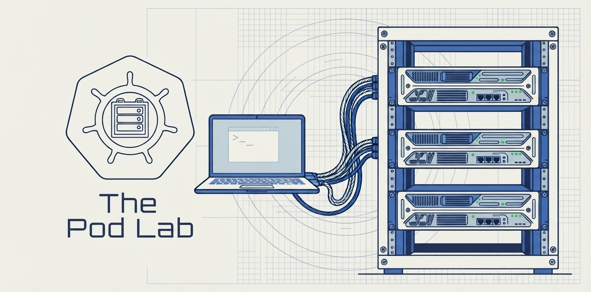
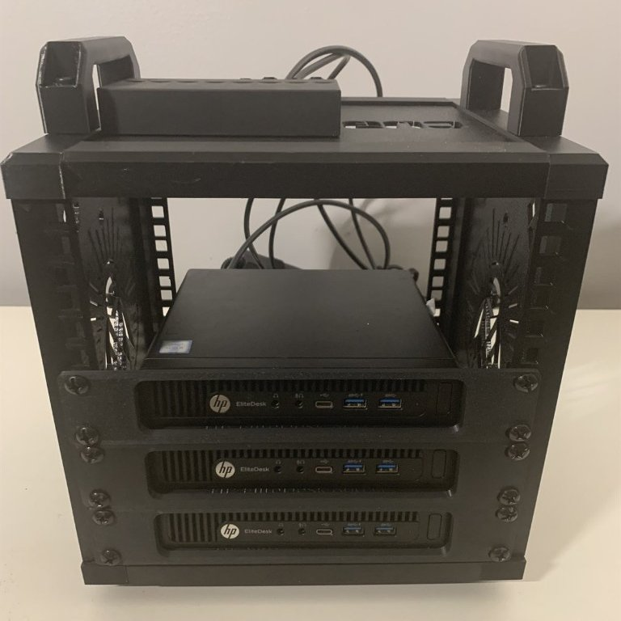

 

---

## Projects

**[FTTX Codex Hub](https://github.com/jaycloud336/fttx-codex-hub)** — a hybrid-access documentation portal for fiber and small-cell field operations. Public installation guides need no login; private engineering runbooks sit behind Google identity. One hostname, two access tiers, no object ACLs.

**Stack** · GCP global HTTPS load balancer, Cloud Storage, Cloud Run, Identity-Aware Proxy, Terraform, GitHub Actions

  

**[International Telecom — Global Landing Zone Architecture](https://github.com/jaycloud336/international-telecom-architecture)** — an interactive visualization of a private hub-and-spoke network on Google Cloud, connecting the Americas, Europe, and Asia-Pacific with VPC Peering and HA VPN with BGP.

**Stack** · Google Cloud, VPC Peering, HA VPN, Cloud Router, BGP, Cloud NAT, GitHub Pages

---

## My Home Lab ("The Pod Lab")

<table>
<tr>
<td width="45%" valign="top">

  

</td>
<td width="55%" valign="top">

A physical **three-node HP EliteDesk mini cluster** in a 3D-printed desktop rack — my dedicated environment for cloud-native experimentation, infrastructure automation, and endless curiosity.

**Hardware** · 3× HP EliteDesk 800 G2 Mini, bare-metal kubeadm  
**Stack** · Kubernetes, Calico, GitOps, automated cluster lifecycle  
**Next up** · Evaluating cluster monitoring & management tooling

### Recent Updates · October 2026

**Ingress controller benchmark** · Compared Traefik, ingress-nginx, and Kong with the same ScopeLens app across burst, load, soak, and stress profiles. All 12 k6 runs completed with 0% HTTP failures and 100% of checks passing; Kong led on this cluster, though the method—not a universal ranking—was the useful result.

**Power resilience** · Added an APC BN450M UPS and relocated the running cluster on battery power with virtually no downtime. Paired with static IPs, it now rides through moves, flickers, and brief outages without a hard crash or network reassignment.

</td>
</tr>
</table>

---

## 🎙️ Pod Talk

Kubernetes networking, security, and platform engineering — explained by building it.

---

## 🎓 Certifications

---

### 📌 Connect

